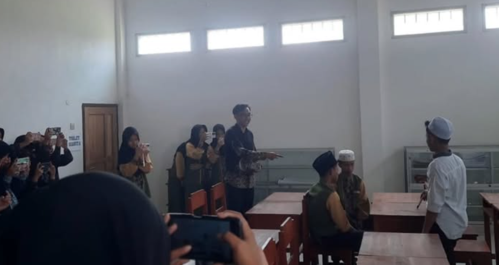

Sebagai bagian dari rangkaian peringatan hari santri, PPMHS mengadakan sayembara film santri untuk mengembangkan kreativitas dalam ranah filmografi dan media digital.

Sebelum memulai perlombaan, santri dibekali dengan teknik dasar filmografi melalui seminar *editing* dan desain grafis pada tanggal 26 September 2026 lalu. Seminar ini dipandu oleh Ustadz Ariel Naafi, S. Kom.

Kemudian selama dua minggu, santri dibebaskan dalam membuat film pendek sesuai kelompok masing-masing dengan tema yang sarat akan kehidupan di pondok pesantren. Hasil produksi tersebut kemudian ditampilkan di hari Sabtu malam (10/10/2026) untuk disaksikan bersama-sama oleh seluruh sivitas PPMHS dan dinilai oleh dewan juri. Pemenang lomba akan diumumkan pada puncak acara hari santri, 22 Oktober 2026, mendatang.